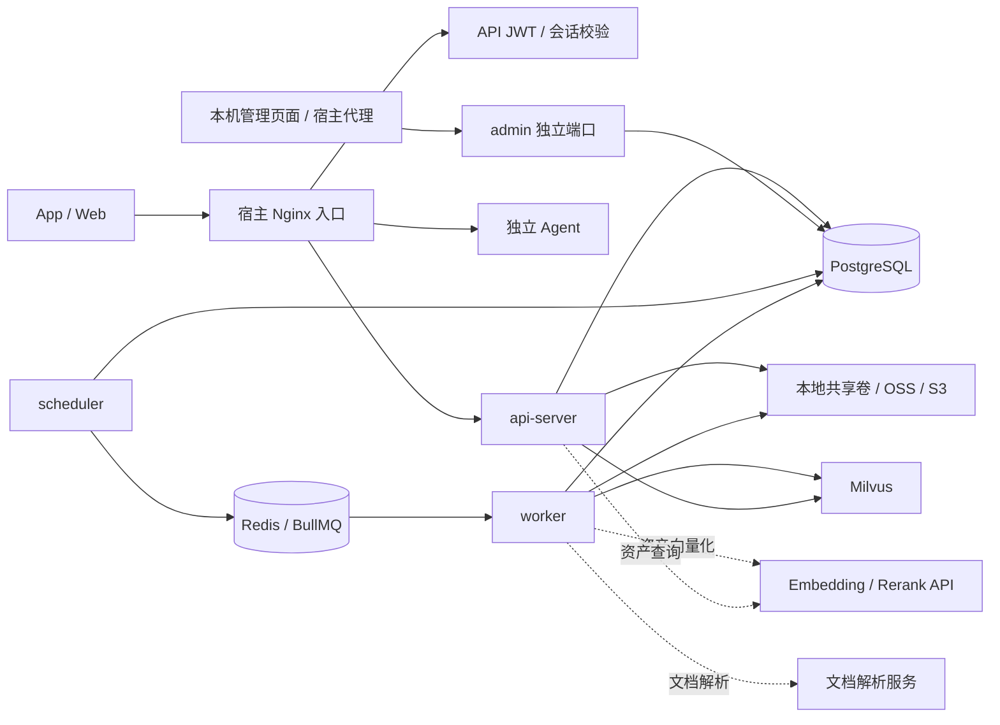

# 花火 Server

花火应用的独立后端，使用 Fastify、TypeScript/ESM、PostgreSQL、Redis 和 BullMQ。一个仓库、一份应用镜像，按 API、Admin、Worker、Scheduler 四个角色分别运行；宿主入口统一鉴权并转发，数据库迁移由一次性 `migrate` 执行。

本文说明首次运行、依赖、服务关系、开发与发布入口。实际配置以代码、`compose.yaml` 和环境模板为准；功能状态与验收边界见 [开发进度](docs/progress.md)。

业务代码、数据库、API 和文档统一使用 `ContentAsset`（资产）与 `Resource`（原文件）。底层索引模式使用 `hybrid` 和 `keyword`。 [资产与搜索术语](docs/content-assets.md)

## 运行环境与工具

| 工具或依赖 | 版本 / 要求 | 用途 |
| --- | --- | --- |
| Git | 支持项目正常分支、PR 与完整提交历史 | 代码、发布基准及迁移差异核对 |
| [Volta](https://docs.volta.sh/guide/getting-started) | 项目的 Node / pnpm 版本管理工具 | 进入仓库后使用 `package.json` 中的 pin |
| Node.js | 宿主与 CI：`26.11.0`；engines：`>=26.11.0 <27` | 开发、构建、测试及宿主脚本 |
| pnpm | `10.15.1` | 安装依赖；提交并使用 `pnpm-lock.yaml` |
| [Docker + Compose 插件](https://docs.docker.com/compose/install/) | 使用 `docker compose`；macOS 可用 Docker Desktop，Linux 可用 Engine 与 Compose 插件 | 本地依赖、应用容器和隔离集成测试 |
| Bash、curl | 宿主命令行可用；Windows 使用 WSL2/Linux 环境 | 项目 shell 脚本和健康检查 |
| PostgreSQL | 本地/CI 镜像 `postgres:17.9-bookworm`，也支持已配置的 RDS | 业务数据、会话、运行配置、任务、Outbox |
| Redis | 本地/CI 镜像 `redis:7.4.8-bookworm` | 缓存、BullMQ 投递、并发与节点协调 |

Docker 构建/运行镜像目前固定为 `node:26.12.1-bookworm-slim`，与宿主的 Volta pin 分开维护。无需另装全局 TypeScript、tsx、Vite 或 pnpm 之外的 JavaScript 包管理器；项目工具由锁文件安装。

Server 进程本身不要求本机安装 CUDA 或 GPU；解析和模型服务按各自环境准备。Docker 的 CPU/内存须能覆盖计划启动的角色，配额见 compose.yaml；增加本地 Milvus 或多副本时另计资源。

按功能准备的外部依赖：

| 能力 | 依赖与配置边界 |
| --- | --- |
| 文件存储 | `StoragePort` 支持本地卷、阿里云 OSS、S3；同机 API/Worker 可共用本地卷，跨主机不能各用一份不共享的目录 |
| 知识库 | 通过 Milvus 实现资产入库与资产查询，支持资产向量化和可选重排；搜索产品细节待定，现有技术参数不作为需求 |
| PDF / Office | 文档解析服务；按后台节点配置调用常驻 API 或按需唤醒 ECS，内网地址须在实际运行环境可达 |
| 手机号验证码登录 | 本地可使用飞书测试群。阿里云 SMS 需要 RAM 凭据、已审核签名和模板 |
| Agent 等服务 | 内部地址直连，传递可信用户/会话身份；不携带 JWT 或 ServiceKey |

未配置某项外部能力，不代表启动检查验证了它；也不要把 Mock、demo 任务或健康检查当作真实模型/解析验收。外部服务手册见文末。

## 服务关系



API 先在 PostgreSQL 事务中保存业务任务和 Outbox，Scheduler 再投递至 Redis/BullMQ，Worker 领取后通过 PG 租约执行并发布结果；Redis 不是业务结果的唯一存储。各角色使用自己的数据库账号，连接同一业务库与相应 Redis 逻辑库/命名空间。Admin 管理会话、配置和节点状态也依赖这些共享服务。

| 角色 | 主要职责 | 默认宿主端口 |
| --- | --- | --- |
| `api-server` | 用户 API、上传下载、事件流、认证回调 | 受限业务 `127.0.0.1:3000`；指标 `9464` |
| `admin` | 独立管理员鉴权、工作台、运行配置 | 直接发布 `127.0.0.1:3001`；指标 `9465` |
| `worker` | 消费任务、处理文件、索引、节点启动步骤 | 仅指标 `9466`，不开放业务端口 |
| `scheduler` | 恢复/扫描任务、Outbox 投递、时间窗、节点空闲监控 | 仅指标 `9467`，不开放业务端口 |
| `migrate` | 校验历史并执行尚未应用的编号迁移 | 一次性成功退出，不是常驻服务 |

默认宿主映射绑定 loopback；容器内健康端口不等于宿主对外端口。API 不装载 Admin 路由。一个容器只运行一个角色，不用 PM2/supervisor 在容器内混跑。

宿主入口调用 Server 的鉴权接口，验证 JWT、账号和会话后转发 `/api/v1/...` 与 `/agent/api/...`。业务接口消费可信身份，继续校验资源权限；Admin 使用自己的独立端口与管理会话。入口、域名、证书和切流由宿主独立维护，不进入应用 Compose 或项目发布脚本。Server 只维护[入口鉴权契约](docs/runbooks/gateway-auth.md)、应用监听、公开 URL 和可信代理配置。`pnpm compose` 直接调用 Docker Compose，不依赖业务分支。

当前按 **API + Worker + Scheduler 同机成组，Admin 可独立部署** 使用，不要求拆仓库。Admin 跨机需连接原业务库和 Redis，并沿用该角色的账号及密钥；API/Worker 跨机前还须处理共享文件。更大范围的共享存储改造按实际拆分需要安排，见 [角色部署](docs/runbooks/role-deployment.md)。

## 首次准备

### 1. 获取代码并安装工具

先准备 GitHub 仓库访问权限与 Git 认证。开发分支使用 `test`；功能修改从它创建工作分支，再通过 PR 合回 `test`。`main` 当前承担受保护的发布控制代码，不等于生产环境，详见 [团队发布](docs/runbooks/team-releases.md)。

```bash
git clone git@github.com:kyriswu/huahuo-server.git
cd huahuo-server
git switch test

# 先安装并启用 Volta；下面安装项目固定版本。
volta install node@26.11.0
export VOLTA_FEATURE_PNPM=1
volta install pnpm@10.15.1

node --version
pnpm --version
docker version
pnpm compose version
pnpm install --frozen-lockfile
```

将 `VOLTA_FEATURE_PNPM=1` 放入所用 shell 的启动配置，保持后续终端一致，见 [Volta 的 pnpm 支持说明](https://docs.volta.sh/advanced/pnpm)。无需同时使用 nvm/Corepack 管理本项目的同一套工具。Docker daemon 须已启动，项目脚本不会切换到远程 Docker context。

只做构建或运行 Server 不依赖 Flutter/App 仓库。需要核对 App 契约时，将已有 App 放在同级 `../huahuo-ai`，仅使用 `pnpm app:reference` / `pnpm app:reference:diff` 只读核对；不在本项目安装 Flutter 或修改 App。

### 2. 初始化本地环境

首次在仓库根目录创建 `.env`，使用已启动的本地 Docker。

```bash
node scripts/init-local.mjs
```

初始化使用 `huahuo-server-local` 项目、`local-db` profile、独立 PostgreSQL 和 Redis、本地文件存储以及各角色的随机凭据。处理节点默认停用（`PROCESSING_NODES_ENABLED=false`）。初始化会保留已有配置和卷。从旧版切换时先按[本地开发手册](docs/runbooks/local-development.md)核对原数据库、项目和端口。

在本机 `.env` 私下填入 `SMS_FEISHU_WEBHOOK_URL`。测试群机器人启用签名时，同时填写 `SMS_FEISHU_SIGNING_SECRET`。验证码由测试群接收。阿里云发送所需设置见 [短信配置](docs/runbooks/sms.md)。

登录时 API 会校验 App 提交的用户协议和隐私政策版本。初始化写入的两个版本与当前 App 一致。

### 3. 构建、迁移并启动

```bash
docker compose --env-file .env up -d --wait postgres redis
pnpm compose:up
curl --fail --retry 10 --retry-connrefused http://127.0.0.1:3000/health/ready
curl --fail --retry 10 --retry-connrefused http://127.0.0.1:3001/health/ready
```

Compose 先运行一次性 `migrate`，成功退出后启动 API、Admin、Worker 和 Scheduler。用 `docker compose --env-file .env ps -a` 查看状态，`migrate` 显示 `Exited (0)` 表示迁移成功。

App 调试使用 `HUAHUO_SERVER=http://127.0.0.1:3000`，受保护的业务接口仍需通过现有可信鉴权入口。Admin 页面为 `http://127.0.0.1:3001/admin`。首次账号通过 stdin JSON 创建。 [Admin bootstrap](docs/runbooks/p02-identity.md#管理员-cli-和会话)

### 其他环境与调试方式

| 模板 | 场景 |
| --- | --- |
| [.env.example](.env.example) | 主配置示例，按需准备已有服务连接 |
| [.env.compose.local.example](.env.compose.local.example) | 手动准备独立 PostgreSQL 和 Redis，使用 `local-db` profile |
| [.env.compose.cloud.example](.env.compose.cloud.example) | 使用可达数据库地址的云端 Compose 联调 |
| [.env.host.example](.env.host.example) | 在宿主运行 Node，通过宿主可达的地址连接依赖 |

不同目标各自保管配置、数据库角色凭据和 TLS 设置。宿主调试和已有 Compose 环境见 [本地开发手册](docs/runbooks/local-development.md)。

## 配置放在哪里

- **ENV / 部署配置**：连接、凭据、监听、公开/内部服务地址、云控制开关、固定模型规格和集合绑定。
- **Admin → 运行配置 / PostgreSQL**：业务功能、任务并发/重试、文件额度、正文索引预算及发布排空预算。修改业务参数不要再添加一条重复 ENV 覆盖路径。
- **处理节点**：启用处理节点的环境可在后台修改已有节点，新增节点通过受审查的代码清单或迁移发布。凭据保留在运行环境。

环境按部署用途区分：`development` 是本地开发，`test` 是线上测试，`production` 是线上生产。分支名、Docker 的 NODE_ENV 和服务器是否能访问内网都不能代替 APP_ENV。

本地初始化通过 `PROCESSING_NODES_ENABLED=false` 跳过处理节点。需要联调解析时，在对应环境开启并配置节点。`PROCESSING_NODES_CLOUD_CONTROL_ENABLED` 独立控制云端启停，测试和生产默认允许。非本地部署使用各自的 `APP_ENV` 和凭据。

```dotenv
# 线上测试使用 test；线上生产使用 production。
APP_ENV=test
PROCESSING_NODES_CLOUD_CONTROL_ENABLED=true
# ALIYUN_RAM_ACCESS_KEY_ID / ALIYUN_RAM_ACCESS_KEY_SECRET 沿用已授权的实际凭据。
```

本期测试发布在写库前核对五角色的 APP_ENV，并核对四常驻角色的云控制开关和完整 RAM 凭据；migrate 不注入云凭据。旧 ENV 若显式为 false，需先按[测试配置片段](resources/processing-nodes/test-control.env.example)改为 true 并重新创建容器。此断言只验证本地配置，不调用云接口，RAM 实际权限和网络仍需验收；解析 API 是否可达不影响云端开机。详见 [运行配置](docs/runbooks/runtime-configuration.md) 和[本期验收边界](docs/acceptance/cloud-control-environments.md)。

改 `.env` 后需按发布流程重新创建对应容器；`docker restart` 不会重新读取新的 ENV。不要把开发环境文件直接覆盖到测试服。

## 日常开发与检查

| 命令 | 作用 |
| --- | --- |
| `pnpm typecheck` | 严格 TypeScript 检查，覆盖后端、测试与 Admin UI |
| `pnpm lint` | 代码和脚本规范检查 |
| `pnpm build` | 清理并生成后端 dist、source maps 与 Admin UI |
| `pnpm test` | 单元与契约测试；外部异常分支可以使用明确的替身 |
| `pnpm test:integration` | 临时 PG/Redis，包含发布基准到候选的迁移演练；不读取业务 `.env` |
| `pnpm db:generate descriptive_name` | 生成新编号迁移草稿，填写审查后才能发布 |
| `pnpm release:check` | 构建后检查干净候选提交与发布计划；不是部署命令 |

首次集成测试先准备本机镜像，运行器不会自动拉取：

```bash
docker pull postgres:17.9-bookworm
docker pull redis:7.4.8-bookworm
pnpm test:integration
# 可选：再准备 milvusdb/milvus:v2.6.26，运行 pnpm test:integration --milvus。
```

临时依赖使用随机测试库、凭据、回环端口及归属标记，结束只清理本轮资源，不清开发库或已有数据卷。真实模型、解析器、OSS、节点开停与中心监控必须在可达环境另做实际验收；替身或健康通过不能代替它们。见 [真实服务待办](docs/acceptance/pending-live-verification.md)。

CI 的 APP_ENV 也使用 test，但隔离运行器会显式关闭云控制及真实供应商，不继承业务凭据；它与测试服务器的部署授权分开。

宿主直接运行不会自动加载 `.env`，应明确选择宿主环境文件，在不同终端运行需要的角色，例如：

```bash
node --env-file=.env.host --import tsx src/entrypoints/api-server.ts
# Worker 另准备其自己的环境文件与 DATABASE_URL：
node --env-file=.env.host.worker --import tsx src/entrypoints/worker.ts
# Admin / Scheduler 同理；不要将 API 数据库账号复用给其他角色。
```

`.env.host` 需自行从模板准备；宿主直连 Redis/PG 还需实际可达地址或受控端口，不假定 Compose 已公开它们。`pnpm dev:admin-ui` 启动 UI 开发服务，默认 `http://127.0.0.1:4173/admin/`；已删除示例登录绕过，登录及真实管理操作需使用有同源 API 的 Admin 服务。

没有宿主 pnpm 时可用 `bash scripts/tooling.sh install --frozen-lockfile` 及 `bash scripts/tooling.sh typecheck` 等工具容器命令；容器只挂 Server。Compose 编排、隔离依赖和 App 参照脚本仍在宿主执行，不能给业务容器挂 Docker socket。

## 上线、下线与恢复

当前约定：**业务 PR → test → 同 SHA push CI → main 中的测试发布流程 → 原测试服务器**。普通 test PR 可使用 GitHub 原生 Auto-merge，main 控制代码由 owner 审核；main/test 同步通过 PR。正式生产执行器尚未接入，不能把 main 或 production environment 的存在当作生产已部署。

1. 从目标实际成功部署 SHA 整理累计变更，更新 `scripts/release/plan.json`；不要拿分支最新头冒充已部署版本。SQL、ENV、任务协议、权限、存储和外部依赖都纳入审查。
2. 完成检查和隔离演练；准备实际配置快照、必要迁移/配置断言及选定冒烟。缺少认证凭据不能跳过后宣称成功。
3. 已审候选合入后，固定流程执行五阶段：**预检/构建/配置 → 迁移 → 迁移验收 → 容器切换退出 → 冒烟清理**。无 pending 迁移也核对历史并显示“无需执行”。
4. 共享队列按 **Worker → Scheduler → API** 交接，Admin 独立处理；先让新 Worker ready、全部旧 Worker 停领新任务，再交接其他角色。旧任务的租约、结果、回调及幂等不能丢。
5. 从入口撤出旧实例后排空并退出：SIGUSR2 撤 readiness，SIGTERM/SIGINT 进入退出。readiness 变 503 本身不会自动切换路由；仍落到 draining API 的合法请求在退出前继续按契约处理。

`deployment.drainTimeoutMs` 存在数据库，默认 10 分钟、允许 10—60 分钟；任务提前结束即退出，到期仍未完成用 `124` 标识强退。`OK_WITH_FORCED_DRAIN` 表示更新完成但发生过强退，不等于无损。Compose 的 3630 秒是保护上限，不是固定等待时间。

发布失败先查既有调用、容器及已提交迁移，再决定恢复；客户端超时不证明远端未执行。回退应用不撤销已提交迁移、不运行旧迁移器。只清理明确归属且不再使用的应用资源，保留当前和上一个成功镜像；不删业务数据卷。

本地仅暂停本项目服务可用 `docker compose --env-file .env stop api-server admin worker scheduler`，它不是线上发布流程。域名入口、反向代理、证书及宿主切流由部署侧独立维护，不在本仓库添加相关配置或脚本。完整规则见 [团队发布](docs/runbooks/team-releases.md)、[标准发布](docs/runbooks/standard-release.md) 和 [排空协议](docs/runbooks/application-lifecycle.md)。

## 开发规范

- 后端只在本仓库修改；同级 App 只读参照，不合并为父级 workspace，也不运行会写 App 的 Flutter 命令。
- 使用严格 TypeScript + ESM、项目 pin 和锁文件；真实配置、凭据、签名 URL、原始敏感日志不进入 Git。
- 数据库关联使用普通 ID 与必要索引，**不新增物理外键或模拟外键触发器**；存在性、归属、并发和清理由 Service/Repository 在事务边界处理。
- 测试服已上线，`0001_initial_schema.sql` 与所有已执行迁移冻结；后续新增编号，不改历史 SQL/checksum、不在启动时 DROP 或重置。
- CI 使用独立 PG/Redis，不携带生产凭据或调用真实付费业务。分别记录单元替身、真实依赖、实际环境验收，不能混写证据。
- 具体工作约束以 [AGENTS.md](AGENTS.md) 为准；发布准备使用 [huahuo-release Skill](.agents/skills/huahuo-release/SKILL.md)，普通开发不自动获得部署权限。

## 观察与排查

`/health/live` 表示进程存活，`/health/ready` 表示当前实例可接流；两者不证明真实业务全链路成功。Prometheus 使用各角色独立 `/metrics`，默认宿主端口 `9464–9467`；环境标签来自 APP_ENV，production 映射为 prod。中心采集使用实际私网地址，并覆盖每个实例。

Docker JSON 日志继续交给现有 Dozzle。按角色、时间和路由找到 5xx 后，以 traceId 关联脱敏异常链和 stack；启动保留 source maps 参数以定位 TypeScript 行号。操作见 [Prometheus](docs/runbooks/prometheus.md)、[应用日志](docs/runbooks/application-logs.md)。

## 目录与进一步阅读

| 路径 / 手册 | 内容 |
| --- | --- |
| `src/apps/`、`src/entrypoints/` | 应用工厂与独立角色入口 |
| `src/modules/`、`src/integrations/`、`src/lib/` | 领域业务、外部适配器与公共运行库 |
| `migrations/`、`infra/` | 编号迁移和本地基础设施初始化 |
| `admin-ui/`、`resources/` | Admin 页面及 tokenizer、节点/服务配置资源 |
| `tests/`、`scripts/` | 测试、宿主工具和固定发布/验收脚本 |
| [认证与 Admin](docs/runbooks/p02-identity.md) | 用户 JWT、会话、管理员初始化 |
| [运行配置](docs/runbooks/runtime-configuration.md) | ENV/数据库边界、节点及业务参数 |
| [文档提取](docs/runbooks/document-extraction.md) / [解析机](docs/runbooks/document-parser-machine.md) | 异步解析、稳定 UUID、云操作与协调 |
| [知识库](docs/runbooks/milvus.md) / [文本入库](docs/runbooks/text-ingestion.md) | 正文解析、入库、索引维护及原文管理 |
| [短信](docs/runbooks/sms.md) / [对象存储](docs/runbooks/user-storage-layout.md) | 供应商配置与存储布局 |
| [发布规范](docs/runbooks/standard-release.md) / [发布冒烟](docs/runbooks/release-smoke.md) | 候选、迁移、配置、退出及验收 |
| [进度](docs/progress.md) / [验收记录](docs/acceptance/) | 当前实现和已知未验收事项 |
